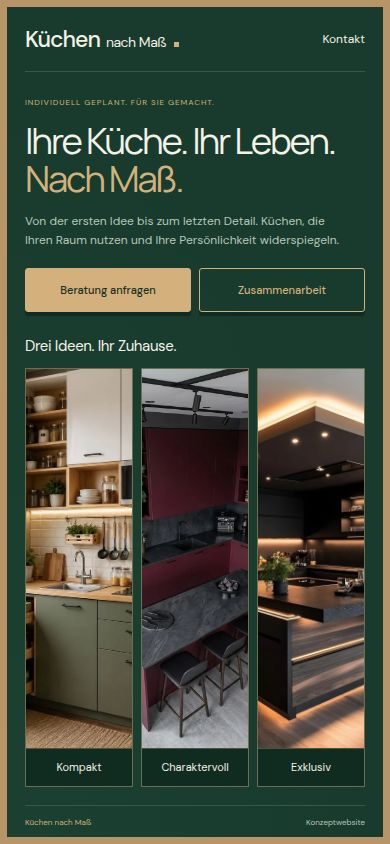

# Küchen nach Maß

**Ihre Küche. Ihr Leben. Nach Maß.**

Eine digitale Visitenkarte für ein Küchenstudio – mit einer ruhigen, bildstarken Gestaltung in Waldgrün, warmen Holzfarben und hellen Naturtönen. Drei unterschiedliche Küchenwelten zeigen, wie individuell ein Raum gestaltet werden kann.

Das deutschsprachige Portfolio-Konzept verbindet eine bildschirmfüllende Präsentation mit direkten Kontaktmöglichkeiten. Ohne zusätzliche Inhaltsseiten, Pfeilsymbole oder Nummerierungen.

## Vorschau

### Desktop


### Mobil



Die Screenshots zeigen die tatsächliche lokale Umsetzung bei 1440 × 900 und 390 × 844 Pixeln.

## Funktionen

- **Eine Bildschirmhöhe:** responsive Hauptansicht mit `100dvh`, ohne vertikales Scrollen der Startseite bei den dargestellten Standardgrößen.
- **Drei Küchenwelten:** Kompakt, Charaktervoll und Exklusiv, jeweils mit eigenem Fotomotiv.
- **Sanfte Bildanimation:** Die Fotos starten leicht vergrößert und verkleinern sich weich auf ihre endgültige Größe.
- **Vergrößerte Fotoansicht:** Ein Klick auf ein Küchenmotiv öffnet das Bild in einem Dialog.
- **Spürbare Buttons:** Schatten und eine dezente Bewegung simulieren das Drücken einer echten Taste.
- **Beratungsanfrage:** Name, Telefonnummer sowie gewünschtes Datum und Uhrzeit für einen Rückruf.
- **Zusammenarbeit:** zusätzlich ein Textfeld für den Kooperationsvorschlag.
- **Formularprüfung:** Pflichtfelder, Telefonnummer, Mindestlänge für Namen und Vorschlag sowie ein Rückrufzeitpunkt in der Zukunft.
- **Zugängliche Dialoge:** beschriftete Felder, Schließen per Escape, Fokus-Rückgabe und verständliche Statusmeldungen.
- **Reduzierte Bewegung:** Animationen werden bei aktivierter Systemeinstellung `prefers-reduced-motion` deaktiviert.
- **Eigenes Favicon:** ein reduziertes Küchenmotiv in den Farben der Website.

Auf kleinen Bildschirmen können längere Formulare innerhalb ihres Dialogfensters gescrollt werden. Die Startseite bleibt dabei im Hintergrund.

## Technischer Aufbau

| Technologie | Einsatz |
| --- | --- |
| React 19 | Benutzeroberfläche, Dialoge und Formularzustand |
| TypeScript | Typisierung der Komponenten und Ereignisse |
| vinext / Vite | Entwicklungsserver und Produktionsbuild |
| CSS | Responsive Grids, Bildschirmhöhen und Animationen |
| Native HTML-Dialoge | Kontaktformulare und Fotoansicht |
| WebP | Optimierte lokale Küchenbilder |
| Google Fonts | DM Sans und Manrope |

Die Website verwendet keine Datenbank. Für die derzeitigen Demoformulare sind keine Zugangsdaten oder Umgebungsvariablen erforderlich. Die Schriftarten werden von Google Fonts geladen.

## Lokal starten

Voraussetzungen: **Node.js ab 22.13.0** und npm.

```bash
npm ci
npm run dev
```

Anschließend die im Terminal angezeigte lokale Adresse öffnen, normalerweise [http://localhost:3000](http://localhost:3000).

### Code prüfen und bauen

```bash
npm run lint
npm run build
```

## Projektstruktur

```text
app/
├── page.tsx              # Startseite, Fotodialog und Kontaktformulare
├── layout.tsx            # Sprache, Seitentitel und Metadaten
└── globals.css           # Layout, Farben, responsive Regeln und Animationen
public/
├── favicon.png
└── images/
    ├── kompakt.webp
    ├── design.webp
    └── exklusiv.webp
docs/
└── screenshots/
    ├── desktop.png
    └── mobile.png
build/                    # Sites-Integration für den Build
worker/                   # Cloudflare-Worker-Einstiegspunkt
.openai/hosting.json       # Zuordnung zur bestehenden Sites-Veröffentlichung
vite.config.ts            # vinext-, Vite- und Worker-Konfiguration
```

## Status der Formulare

**Beide Formulare sind Demonstrationen.** Sie prüfen die Eingaben im Browser, versenden aber keine Nachrichten und speichern keine Anfragedaten auf einem Server. Nach einer gültigen Eingabe wird ausdrücklich darauf hingewiesen, dass die Anfrage nicht versendet wurde.

Vor einem echten Einsatz müssen E-Mail-Versand oder ein passender Formular-Endpunkt eingerichtet werden. Der vorgeschlagene Rückrufzeitpunkt wird in der lokalen Zeitzone der anfragenden Person eingegeben. Es gibt weder Kalenderabgleich noch automatische Terminreservierung; ein Termin muss persönlich bestätigt werden.

## Veröffentlichung

Die aktuelle Build-Konfiguration ist für **Sites / Cloudflare Workers** eingerichtet und erzeugt einen Worker-basierten Build. Die vorhandene Sites-Veröffentlichung ist privat und kann eine Anmeldung verlangen.

Ein GitHub-Repository kann den gesamten Quellcode und diese Dokumentation enthalten. **GitHub Pages kann den aktuellen Worker-Build nicht direkt ausführen.**

Für eine Veröffentlichung auf **Vercel** muss die bestehende vinext-/Worker-Konfiguration zunächst auf eine dort unterstützte Build- und Laufzeitkonfiguration umgestellt werden. Ein unveränderter Import als gewöhnliches Next.js-Projekt ist nicht die vorgesehene Bereitstellung dieser Version.

## Konzept & Bildmaterial

Entwickelt von **Olha Khodakivska** als Webentwicklungs-Portfolio-Konzept auf Grundlage bereitgestellter visueller Referenzen und Küchenbilder. „Küchen nach Maß“ ist die Bezeichnung des Konzepts; es werden keine realen Kundenprojekte oder Referenzaufträge behauptet.

Die bereitgestellten Fotos dienen der visuellen Präsentation. Dieses Repository erteilt keine Nutzungsrechte an den Bildern; vor einer kommerziellen Verwendung sind die jeweiligen Rechte zu klären.
