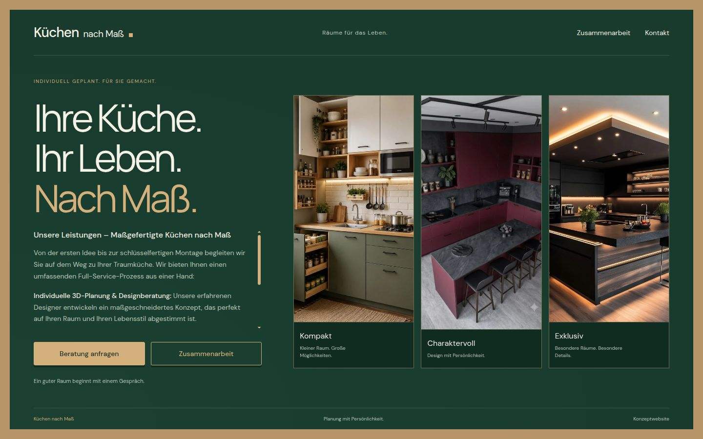

# Küchen nach Maß

**Ihre Küche. Ihr Leben. Nach Maß.**

Eine digitale Visitenkarte für ein Küchenstudio – mit einer ruhigen, bildstarken Gestaltung in Waldgrün, warmen Holzfarben und hellen Naturtönen. Drei unterschiedliche Küchenwelten zeigen, wie individuell ein Raum gestaltet werden kann.

Das deutschsprachige Portfolio-Konzept verbindet eine bildschirmfüllende Präsentation mit direkten Kontaktmöglichkeiten. Ohne zusätzliche Inhaltsseiten, Pfeilsymbole oder Nummerierungen.

## Vorschau

### Desktop



### Mobil


Die Screenshots zeigen die tatsächliche lokale Umsetzung bei 1440 × 900 und 390 × 844 Pixeln.

## Funktionen

- **Eine Bildschirmhöhe:** responsive Hauptansicht mit `100dvh`, ohne vertikales Scrollen der Startseite bei den dargestellten Standardgrößen.
- **Drei Küchenwelten:** Kompakt, Charaktervoll und Exklusiv, jeweils mit eigenem Fotomotiv.
- **Sanfte Bildanimation:** Die Fotos starten leicht vergrößert und verkleinern sich weich auf ihre endgültige Größe.
- **Vergrößerte Fotoansicht:** Ein Klick auf ein Küchenmotiv öffnet das Bild in einem Dialog.
- **Spürbare Buttons:** Schatten und eine dezente Bewegung simulieren das Drücken einer echten Taste.
- **Beratungsanfrage:** Name, Telefonnummer sowie gewünschtes Datum und Uhrzeit für einen Rückruf.
- **Zusammenarbeit:** zusätzlich ein Textfeld für den Kooperationsvorschlag.
- **Formularprüfung:** Pflichtfelder, Telefonnummer, Mindestlänge für Namen und Vorschlag sowie ein Rückrufzeitpunkt in der Zukunft.
- **Zugängliche Dialoge:** beschriftete Felder, Schließen per Escape, Fokus-Rückgabe und verständliche Statusmeldungen.
- **Reduzierte Bewegung:** Animationen werden bei aktivierter Systemeinstellung `prefers-reduced-motion` deaktiviert.
- **Eigenes Favicon:** ein reduziertes Küchenmotiv in den Farben der Website.

Der vollständige Leistungstext steht in einem eigenen, per Tastatur und Touch scrollbar zugänglichen Bereich. So bleiben die Kontaktbuttons und Küchenbilder auf der bildschirmfüllenden Startseite erreichbar. Auf kleinen Bildschirmen können längere Formulare innerhalb ihres Dialogfensters gescrollt werden.

## Technischer Aufbau

| Technologie | Einsatz |
| --- | --- |
| HTML5 | Semantische Struktur, native Dialoge und Formularfelder |
| CSS3 | Responsive Grids, Bildschirmhöhen, Farben und Animationen |
| Vanilla JavaScript | Dialogsteuerung, Fotoansicht und Formularprüfung |
| WebP | Optimierte lokale Küchenbilder |
| Google Fonts | DM Sans und Manrope |

Kein Framework, keine npm-Abhängigkeiten und kein Build-Schritt. Die Schriftarten werden von Google Fonts geladen. Es werden keine Datenbank oder Zugangsdaten benötigt.

## Lokal starten

Den Projektordner in VS Code öffnen und **Live Server** starten. Alternativ im Projektverzeichnis:

```bash
python3 -m http.server 5500
```

Dann [http://localhost:5500](http://localhost:5500) öffnen. Die Website kann auch direkt über `index.html` geöffnet werden.

## Projektstruktur

```text
kuechen-card/
├── index.html           # Startseite, Fotodialog und Kontaktformulare
├── style.css            # Unveränderte Gestaltung und Animationen
├── script.js            # Dialoge, Fokussteuerung und Validierung
├── favicon.png
├── images/
│   ├── kompakt.webp
│   ├── design.webp
│   └── exklusiv.webp
├── docs/
│   └── screenshots/
│       ├── desktop.png
│       └── mobile.png
└── README.md
```

## Status der Formulare

**Beide Formulare sind Demonstrationen.** Sie prüfen die Eingaben im Browser, versenden aber keine Nachrichten und speichern keine Anfragedaten auf einem Server. Nach einer gültigen Eingabe wird ausdrücklich darauf hingewiesen, dass die Anfrage nicht versendet wurde.

Vor einem echten Einsatz müssen E-Mail-Versand oder ein passender Formular-Endpunkt eingerichtet werden. Der vorgeschlagene Rückrufzeitpunkt wird in der lokalen Zeitzone der anfragenden Person eingegeben. Es gibt weder Kalenderabgleich noch automatische Terminreservierung; ein Termin muss persönlich bestätigt werden.

## Veröffentlichung mit GitHub Pages

1. Den Quellcode einschließlich `images/`, `favicon.png` und `docs/screenshots/` in das GitHub-Repository pushen.
2. Unter **Settings → Pages** die Quelle **Deploy from a branch** auswählen.
3. Den Branch mit der Website (normalerweise `main`) und den Ordner **/ (root)** wählen.
4. Speichern und warten, bis GitHub die Website veröffentlicht hat.

Die lokalen Dateien werden mit relativen Pfaden eingebunden. Dadurch funktioniert die Website auch unter einer GitHub-Pages-Repository-Adresse. Es ist keine Anmeldung für Besucher erforderlich, und es werden keine Build- oder Servereinstellungen benötigt.

Die ursprüngliche React-/vinext-Umsetzung wurde durch HTML, CSS und JavaScript ersetzt. Desktop- und Mobilansicht wurden bei 1440 × 900 und 390 × 844 Pixeln mit den ursprünglichen Screenshots verglichen; die Ansichten waren pixelgleich.

## Konzept & Bildmaterial

Entwickelt von **Olha Khodakivska** als Webentwicklungs-Portfolio-Konzept auf Grundlage bereitgestellter visueller Referenzen und Küchenbilder. „Küchen nach Maß“ ist die Bezeichnung des Konzepts; es werden keine realen Kundenprojekte oder Referenzaufträge behauptet.

Die bereitgestellten Fotos dienen der visuellen Präsentation. Dieses Repository erteilt keine Nutzungsrechte an den Bildern; vor einer kommerziellen Verwendung sind die jeweiligen Rechte zu klären.
